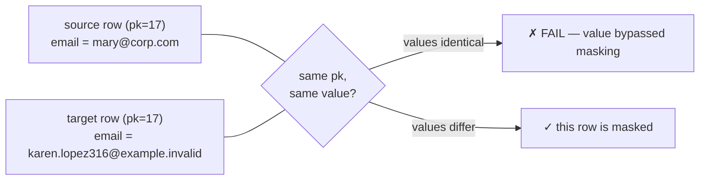

# Validation — check the work

Masking you cannot verify is hope, not a control. `dbmask validate` compares
the **masked** database (`database`) against the **untouched original**
(`source_database`) and exits non-zero on failure, so it slots directly into
a CI/CD gate:

```bash
dbmask validate --config dbmask.yaml --strict
```

## The three checks

| # | Check | What it proves |
|---|---|---|
| 1 | **Row counts** | masking changed values — it never added or dropped rows |
| 2 | **Schema elements** | columns/types, primary key, indexes, foreign keys, unique & check constraints all match |
| 3 | **Masking completeness** | per-row: no sensitive value survived unchanged |

Tables that exist on only one side are reported as warnings — nothing is
silently skipped.

## How completeness is checked

### Preferred: primary-key aligned

When source and target share a usable primary key, there is no guessing
about which row corresponds to which: rows are matched key-by-key and the
sensitive column is compared **value-by-value**.



This catches the failure the older heuristic could not: a row where the
email survived unmasked *while the name changed* — the row as a whole
differs, but the sensitive value is right there.

Coverage is bounded by `validation.pk_row_limit` (default 5 000 rows per
column, in key order). A larger table produces a **WARNING**, which fails
`--strict` even when all inspected values changed:

```text
[!] masking_completeness  main.people.email: PK-aligned comparison of 5000 row(s):
    checked values differ from their source, but coverage is partial — first 5,000
    row(s) in key order. Remaining rows were not verified.
```

The collector reads one extra row to distinguish a genuinely partial comparison
from a table with exactly 5 000 rows. Raise the budget above the table size, or
set it to `null` for an unbounded comparison:

```yaml
validation:
  pk_row_limit: null
```

Full mode retains the selected values and primary keys from both sides in
memory for each column. Choose a finite budget when memory must be bounded;
that budget will not pass strict mode if any rows remain unchecked. Zero,
negative numbers, booleans and non-integer budgets are configuration errors.

Primary-key sets are compared as well as values. With full coverage, missing,
additional or entirely different keys are a **FAIL**, even when row counts
match or the row-count check is disabled. With partial coverage, unmatched
keys in the inspected ranges are a **WARNING**: keys beyond those ranges
cannot be ruled out. Both modes prevent a strict pass over zero aligned rows.
Two empty tables produce **SKIPPED**, because no values were compared.

### Fallback: the overlap heuristic (keyless tables)

Without a key, rows cannot be aligned, so the check falls back to: find
values common to both sides (minus obvious test noise), then look for
**entire rows** identical across databases.

Why not just "are there common values?" — because dictionary masking swaps
real values for other real values. If the dictionary contains both `Tesla`
and `Apple` and so does your data, after masking `Tesla → Apple` and
`Apple → Tesla` the *column* still contains both strings while every *row*
changed. A column-level check would cry wolf; the row-level comparison does
not.

Two honesty rules apply to the heuristic:

- an identical whole row is still a hard **FAIL** (it plainly bypassed
  masking);
- a *clean* result is a **WARNING**, not a PASS — "no identical whole rows"
  is consistent with correct masking but cannot prove it. The message says
  exactly that.

## `--strict` and report semantics

| | `passed` (default) | `passed_strict` (`--strict`) |
|---|---|---|
| FAIL / ERROR | ✗ | ✗ |
| WARNING (e.g. partial coverage, unresolved source column, missing table) | ✓ | ✗ |
| SKIPPED (e.g. no sensitive columns supplied) | ✓ | ✗ |

The non-strict summary line names its caveats rather than printing a bare
"PASSED":

```text
RESULT: PASSED ✓ — with 2 warning(s): not everything could be verified (use --strict to fail on this)
```

Use `--strict` in CI. Use the default interactively while iterating.

## Which columns get checked?

`Runner.validate()` and the CLI inventory the **untouched source**, using the
configured schemas, table exclusions, overrides, applicable reviewed history
and patterns. Source classification uses the target's logical database name
for history/override lookup, even when the source connection has another name.
It never invokes an LLM or appends machine suggestions to history. Applying
history expiry/type checks can still demote an invalid approval to pending.

- If `validation.columns` is empty, all sensitive columns found in that source
  inventory receive value checks. Previously stored suggestions cannot hide
  newly encountered source columns.
- An explicit `schema.table.column` list fixes the value-check scope. It does
  **not** silently declare other columns safe. UNKNOWN columns outside the
  list, imported decisions still requiring review, and known sensitive columns
  omitted from the list produce `classification_coverage` **WARNINGs**.
- Explicitly listing an otherwise UNKNOWN column declares it sensitive for
  value comparison. Its values must then pass the completeness check. Listing
  it cannot override an imported pending, expired or invalid review.
- Source classification errors produce a `classification_coverage` **ERROR**.

Resolve warnings by reviewing overrides or approved history, and by including
all intended sensitive columns in the value-check scope. An LLM-only decision
needs review or explicit inclusion; validation does not send source samples
to a model. `mask` still announces UNKNOWN columns without aborting merely
because they are UNKNOWN; `validate --strict` is the downstream release gate.

These checks cover the configured detection scope and enabled validation
checks. Explicitly excluded tables/columns remain policy choices. Low-level
`Validator.validate()` callers supply their own sensitive-column scope and
are responsible for classification coverage themselves.

## Privacy of the reports themselves

Value samples in FAIL details are shape-redacted. Existing unmasked-value
diagnostics also include row keys, which may themselves be sensitive when
natural keys such as emails are used; treat those reports as sensitive.
New key-alignment diagnostics contain counts only, never the unmatched keys.

## Limits to keep in mind

- A finite PK budget compares the first `pk_row_limit` rows per column in key
  order and fails strict mode if coverage is partial. Full mode (`null`) needs
  memory proportional to the selected column and keys on both sides.
- Schema comparison covers what SQLAlchemy exposes portably; triggers and
  grants are not compared (extension point: override
  `Connector.schema_elements`).
- Validation tells you masking *happened*; whether the chosen strategy is
  *strong enough* is a design question — see the
  [security model](security-model.md).
